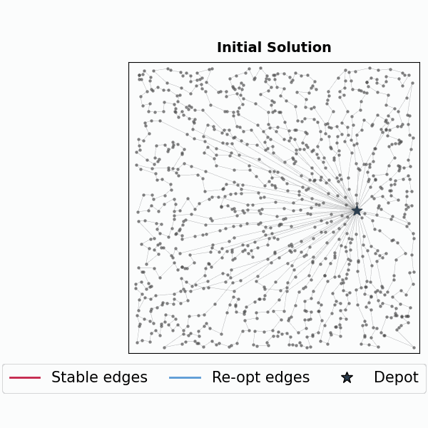
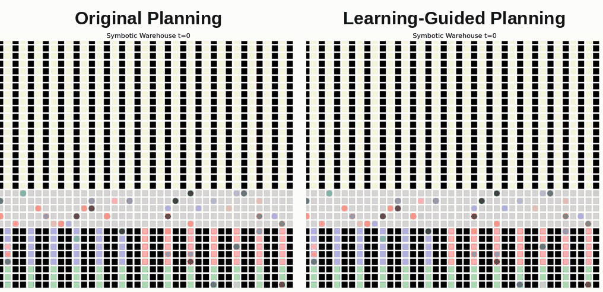
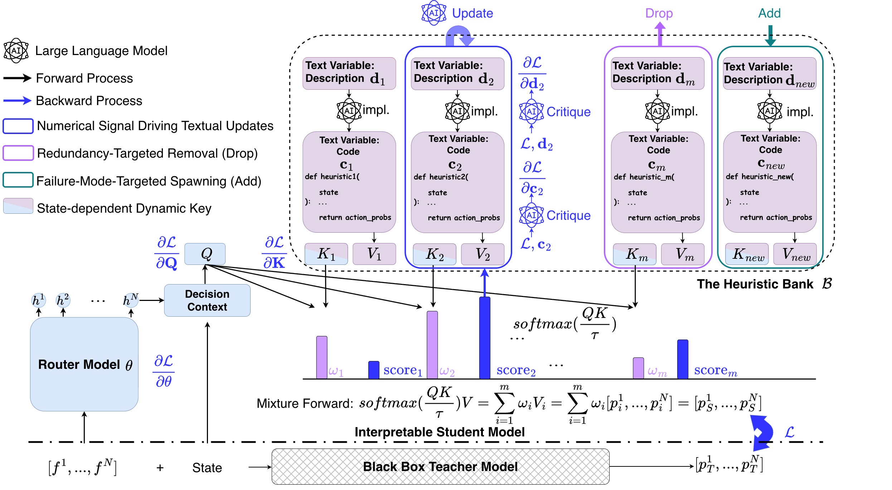
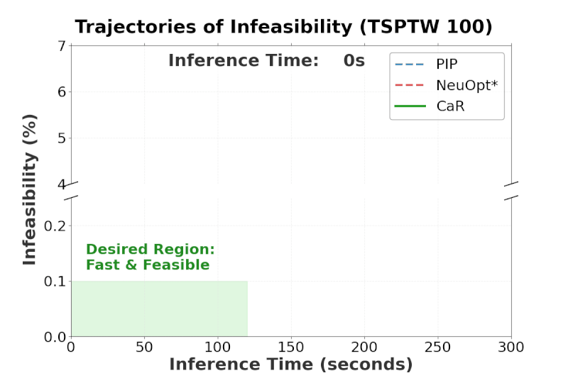
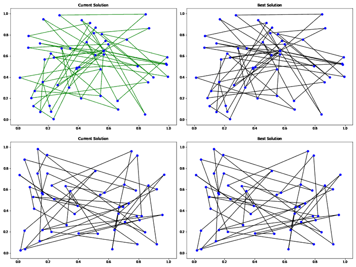
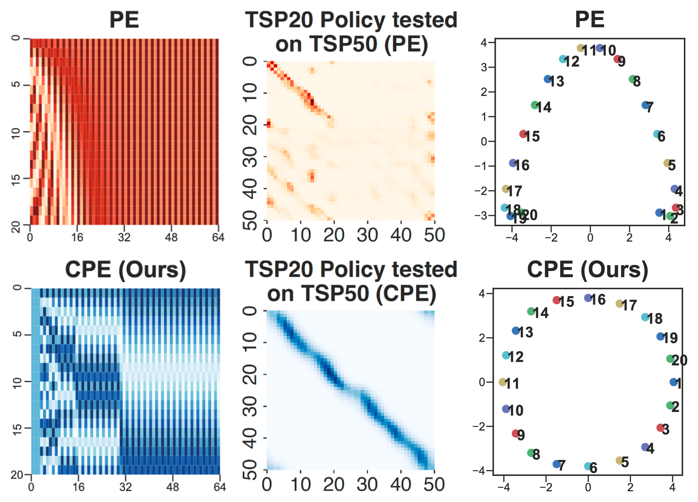

Hi, I am a Postdoctoral Associate at [MIT](https://www.mit.edu/)'s [Laboratory for Information and Decision Systems (LIDS)](https://lids.mit.edu/) since Aug 2024, mentored by [Prof. Cathy Wu](http://www.wucathy.com/). Previously, I was a Research Fellow at Nanyang Technological University (NTU), supervised by [Prof. Jie Zhang](https://personal.ntu.edu.sg/zhangj/). I obtained my Ph.D. in Industrial Systems Engineering at National University of Singapore (NUS) in 2024, where I was mentored by [Prof. Zhiguang Cao](https://zhiguangcaosg.github.io/) and honored to be advised by [Prof. Yeow Meng Chee](https://ymchee66.github.io/home/). 
<!-- I received my B.E. from South China University of Technology (SCUT) in 2019, advised by [Prof. Yuejiao Gong](https://scholar.google.com/citations?user=Mi0Zu3IAAAAJ&hl=en). -->

I work at the intersection of **AI** and **Optimization**, developing next-generation AI-driven solutions to tackle the growing complexity of today’s most challenging problems. I have published 40+ papers in top-tier conferences and journals (multiple oral and spotlight presentations), serve as an **Area Chair (AC) for NeurIPS, ICLR, and ICML**, and have received Top AC and multiple Best Reviewer awards. I also collaborate closely with industry partners including [NVIDIA](https://www.nvidia.com/en-us/), [Amazon](https://www.amazon.com/), [Microsoft Research](https://www.microsoft.com/en-us/research/), [Symbotic](https://www.symbotic.com/), [Routific](https://www.routific.com/) and [Grab (SG)](https://www.grab.com/sg/). 

<!-- Welcome to see my [publications](https://yining043.github.io/publications/), [fundings](https://yining043.github.io/fundings/), [services](https://yining043.github.io/service/), [experience](https://yining043.github.io/experience/), and [honors & awards](https://yining043.github.io/honors/). Drop me an email if you’d like to **collaborate or discuss** with me! You may approach me at:
* **Office**: 45-611, 51 Vassar St, Cambridge, MA 02139 
* **E-mail**: yiningma [at] mit [dot] edu -->

💡 Research Interests
-----

My research focuses on **AI for Optimization and Decision Intelligence**, which asks: *how can AI learn to optimize complex decision-making systems at scale towards decision intelligence?* 

**Research Directions** 🔥
- **Neural Combinatorial Optimization (NCO)** - developing *novel AI methodological frameworks and paradigms* for hard combinatorial optimization problems;
- **Learning-Guided Optimization (LGO)** - leveraging AI to boost Operations Research (OR) algorithms for killer applications, uniting OR’s reliability with AI’s intelligence;
- ** Agentic AI for Accelerating Research** - building *trustworthy*, *self-evolving* AI agents to automate and accelerate research, driving scientific discovery at scale.
<!-- - **Survey, Benchmark & Open-source Library** - [IET Review](https://ietresearch.onlinelibrary.wiley.com/doi/10.1049/cim2.12072) (survey of NCO through 2023), [MetaBox-v2](https://github.com/MetaEvo/MetaBox) (benchmark of learning-guided MetaBBO), [RL4CO](https://github.com/ai4co/rl4co) (library of RL for COP) -->

**Research Keywords** 🔥
- **AI**: Reinforcement Learning, Representation Learning, LLM Agents, Self-Evolving Agents, Recursive Self-Improvement (RSI), Trustworthy and Interpretable AI;
- **Optimization**: NCO, LGO, Mixed-Integer Linear Programming (MILP), Constrained & Stochastic Optimization, GPU-Accelerated Optimization;
- **Application**: Operations Automation (e.g., *manufacturing, warehouses, robotics*), Efficient AI Infrastructure (e.g., *data centers*), Resilient Logistics Networks (e.g., *ports, airports, supply chains*), Sustainable Cities (e.g., *cooling, congestion pricing, transit planning*).

📄 Selected Publications
-----

Representative publications († corresponding author). See all publications [here](https://yining043.github.io/publications/).

  

    

    

      <a class="sp-title" href="https://arxiv.org/abs/2507.01037">Learning to Segment for Vehicle Routing Problems</a>
      
Wenbin Ouyang, Sirui Li, <strong>Yining Ma</strong>†, Cathy Wu

      
International Conference on Learning Representations (ICLR), 2026

      
LGOVRP

      
<a href="https://arxiv.org/abs/2507.01037">📄 Paper</a>Oral (top 1%)

    

  

  

    

    

      <a class="sp-title" href="https://arxiv.org/abs/2603.23838">Learning-Guided Prioritized Planning for Lifelong Multi-Agent Path Finding in Warehouse Automation</a>
      
Han Zheng, <strong>Yining Ma</strong>†, Brandon Araki, Jingkai Chen, Cathy Wu

      
Journal of Artificial Intelligence Research (JAIR), 2026

      
LGOMAPF

      
<a href="https://arxiv.org/abs/2603.23838">📄 Code &amp; Paper</a><a class="sp-badge" href="https://news.mit.edu/2026/ai-system-keeps-warehouse-robot-traffic-running-smoothly-0326">MIT News</a><a class="sp-badge" href="https://www.symbotic.com/blog/the-bottleneck-for-dense-storage-isnt-robot-performance-its-the-traffic/">Symbotic CTO Blog</a>

    

  

  

    

    

      <a class="sp-title" href="https://arxiv.org/abs/2606.19741">Interpreting Neural Combinatorial Optimization via Evolving Programmatic Bottlenecks</a>
      
Haocheng Duan, Yuxin Guo, Jieyi Bi, Anqi Xie, Sirui Li, <strong>Yining Ma</strong>†, Cathy Wu

      
Advances in Neural Information Processing Systems (NeurIPS), 2026

      
LLMNCOInterpretability

      
<a href="https://arxiv.org/abs/2606.19741">📄 Paper</a>

    

  

  

    

    

      <a class="sp-title" href="https://github.com/jieyibi/CaR-constraint">Towards Efficient Constraint Handling in Neural Solvers for Routing Problems</a>
      
Jieyi Bi, Zhiguang Cao, Jianan Zhou, Wen Song, Yaoxin Wu, Jie Zhang, <strong>Yining Ma</strong>†, Cathy Wu

      
International Conference on Learning Representations (ICLR), 2026

      
NCOConstraint Handling

      
<a href="https://github.com/jieyibi/CaR-constraint">💻 Code &amp; Paper</a>

    

  

  

    

    

      <a class="sp-title" href="https://github.com/yining043/NeuOpt">Learning to Search Feasible and Infeasible Regions of Routing Problems with Flexible Neural k-Opt</a>
      
<strong>Yining Ma</strong>, Zhiguang Cao, Yeow Meng Chee

      
Advances in Neural Information Processing Systems (NeurIPS), 2023

      
NCOVRP

      
<a href="https://github.com/yining043/NeuOpt">💻 Code &amp; Paper</a>Cited 150+

    

  

  

    

    

      <a class="sp-title" href="https://github.com/yining043/VRP-DACT">Learning to Iteratively Solve Routing Problems with Dual-Aspect Collaborative Transformer</a>
      
<strong>Yining Ma</strong>, Jingwen Li, Zhiguang Cao, Wen Song, Le Zhang, Zhenghua Chen, Jing Tang

      
Advances in Neural Information Processing Systems (NeurIPS), 2021

      
NCOVRP

      
<a href="https://github.com/yining043/VRP-DACT">💻 Code &amp; Paper</a>Cited 300+

    

  

🎉 News
-----
I'm on the job market! Please contact me if you know of any suitable positions!

* [10/2026] I will serve as an Area Chair for ICML 2027.
* [10/2026] 🎉 I am recognized as a **Top Area Chair** for NeurIPS 2026!
* [10/2026] I will organize the Workshop on Trustworthy AI for CO at ACM TRUST 2027.
* [09/2026] Two papers are accepted by NeurIPS 2026: [EPB](https://arxiv.org/abs/2606.19741) (AI agents for NCO interpretability) and MixRoute (NCO generalization).
* [09/2026] 🎉 I am awarded the [OpenAI ChatGPT for Academic Researchers](https://openai.com/index/chatgpt-for-academic-researchers/) grant.
* [08/2026] 🎉 I am awarded the [Lambda Research](https://lambda.ai/research) grant.
* [08/2026] I will serve as an Area Chair for ICLR 2027.
* [07/2026] I will serve as a Senior Program Committee (SPC) member for AAAI 2027.
* [06/2026] Two papers are accepted as **Orals** at KDD 2026: [AlphaOPT](https://arxiv.org/abs/2510.18428) (AI agent for MILP formulation) and [DyNACO](https://arxiv.org/abs/2606.04039) (LGO for large-scale ACO).
* [05/2026] 🔥 Our LLM RFT work [METIS](https://arxiv.org/abs/2605.11235) is **deployed** in [Amazon Nova Forge](https://docs.aws.amazon.com/nova/latest/nova2-userguide/nova-reinforcement-fine-tuning.html#nova-rft-adaptive-curriculum)!
<!-- * [05/2026] Two papers are accepted by KDD 2026: [DyNACO](https://arxiv.org/abs/2606.04039) (LGO) and [AlphaOPT](https://arxiv.org/abs/2510.18428) (AI agent). -->
<!-- * [04/2026] One paper is accepted by ICML 2026: [Dual-Attention MILP Backbone](https://arxiv.org/abs/2601.04509) (NCO). -->
* [04/2026] I gave a guest lecture on "*Optimization in the Era of AI*" at [MIT](https://web.mit.edu/1.041/www/schedule/) (see [slides](https://web.mit.edu/1.041/www/lectures/L23-guest-lecture-Yining-Ma-2026sp.pdf)).
* [03/2026] 🎊 Our [L-RH-PP](https://arxiv.org/abs/2603.23838) is featured in [MIT News](https://news.mit.edu/2026/ai-system-keeps-warehouse-robot-traffic-running-smoothly-0326)!
* [03/2026] I will serve as an Area Chair for NeurIPS 2026.
<!-- * [03/2026] We are hosting the [MIT 2026 Summer Research Camp](https://mobility.mit.edu/openings/). Welcome to apply! -->
* [02/2026] Our [L2Seg](https://arxiv.org/abs/2507.01037) is selected as an **Oral** at ICLR 2026!
* [01/2026] Three papers are accepted by ICLR 2026: [L2Seg](https://arxiv.org/abs/2507.01037) (LGO for accelerating routing solvers), [CaR](https://github.com/jieyibi/CaR-constraint) (NCO constraint handling), and [RADAR](https://arxiv.org/abs/2603.03388) (NCO asymmetric representation).
* [01/2026] I am awarded the MIT Kaufman Teaching Certificate (see [reference letter](https://drive.google.com/file/d/1Ch94oB34hzxiZdeL3I8rHbwJUsQJnIYo/view?usp=sharing)).
* [01/2026] One paper is accepted by JAIR: [L-RH-PP](https://arxiv.org/abs/2603.23838) (LGO for resolving robot congestion in automated warehouse), in collaboration with [Symbotic](https://www.symbotic.com/).
<!-- * [01/2026] One paper is accepted by TEVC: [LLaMoCo](https://ieeexplore.ieee.org/document/11359290) (LLM). -->
<!-- * [11/2025] I will organize and serve as a session chair of "AI for Planning and Scheduling" in the International Federation of Operational Research Societies (IFORS), 2026. -->
* [10/2025] 🎉 We are awarded an [AI Singapore](https://aisingapore.org/) grant with MIT, NTU, and SMU (see [news](https://www.linkedin.com/posts/aisingapore_exciting-news-in-ai-research-ensuring-activity-7369580064843190272-6bhL/)).
* [09/2025] Three papers are accepted by NeurIPS 2025: [Probing NCO](https://github.com/123zhangzq/NeurIPS2025_probing/) (NCO interpretability, **Spotlight**), [DesignX](https://arxiv.org/abs/2505.17866) (LGO for evolutionary algorithm design), and [MetaBox-v2](https://github.com/MetaEvo/MetaBox) (LGO benchmark for MetaBBO).
* [09/2025] We organized the [LEAD 2025](https://sites.google.com/view/leadworkshop2025/%E4%B8%BB%E9%A1%B5) workshop (see [recordings](https://sites.google.com/view/leadworkshop2025/%E6%B1%87%E6%8A%A5%E5%B1%95%E7%A4%BA%E6%9F%9C)).
* [06/2025] We released [MetaBox-v2](https://github.com/GMC-DRL/MetaBox) 🚀!
* [05/2025] One paper is accepted as an **Oral** by KDD 2025: [RL4CO](https://arxiv.org/abs/2306.17100) (NCO library).
<!-- * [05/2025] One paper is accepted by ICML 2025: [SHIELD](https://arxiv.org/abs/2506.08424) (NCO). -->
* [04/2025] I will serve as an Area Chair for NeurIPS 2025.
* [04/2025] 🎊 Our [L-RHO](https://github.com/mit-wu-lab/l-rho) is featured on the **front page of MIT.edu** (see [MIT News](https://news.mit.edu/2025/faster-way-solve-complex-planning-problems-0416))!
<!-- * [12/2024] One paper is accepted by ICLR 2025: [L-RHO](https://github.com/mit-wu-lab/l-rho) (LGO). -->
* [12/2024] One paper is accepted as an **Oral** by AAAI 2025: [ConfigX](https://github.com/GMC-DRL/ConfigX) (LGO for evolutionary algorithm configuration).
* [12/2024] We hosted an unofficial L2Opt workshop at NeurIPS 2024 (see [photos](https://www.linkedin.com/posts/yiningma_neurips2024-activity-7275701162157207552-jDEb?utm_source=share&utm_medium=member_ios)).
<!-- * [12/2024] ✈️ I will attend NeurIPS 2024 in Vancouver! -->
<!-- * [11/2024] One paper is accepted by KDD 2025: [RF-MA3S](https://github.com/LiQisResearch/KDD--RF-MA3S) (NCO). -->
* [10/2024] I am selected as a NeurIPS 2024 **Top Reviewer** (main and D&B tracks)!
* [09/2024] One paper is accepted by NeurIPS 2024: [PIP](https://github.com/jieyibi/pip-constraint) (NCO constraint handling).
<!-- * [08/2024] One paper is accepted by TPAMI: [NCS](https://github.com/dtkon/PDP-NCS) (NCO). -->
* [08/2024] I joined [Prof. Cathy Wu](http://www.wucathy.com/)'s group at MIT!
* [07/2024] I am selected as an ICML 2024 **Best Reviewer** (top 3%)!
* [06/2024] We released [RL4CO](https://arxiv.org/abs/2306.17100) 🚀!
<!-- * [05/2024] One paper is accepted by KDD 2024: [Hierarchical TSP Solver](https://www.arxiv.org/abs/2408.03585) (NCO). -->
<!-- * [05/2024] One paper is accepted by ICML 2024: [MVMoE](https://github.com/RoyalSkye/Routing-MVMoE) (NCO). -->
* [05/2024] I was promoted to Research Fellow at NTU.
<!-- * [03/2024] One paper is accepted by TNNLS: [DOMAC](https://github.com/sunjing1102628/DOMAC) (MARL). -->
<!-- * [03/2024] One paper is accepted by SMCA: [RL-DAS](https://ieeexplore.ieee.org/abstract/document/10496708) (LGO). -->
* [02/2024] I gave a talk at MIT, hosted by [Prof. Cathy Wu](http://www.wucathy.com/).
* [02/2024] 🎓 I successfully defended my Ph.D. thesis at NUS!

<em>Scroll inside the box to see more ↑↓</em>

(Last updated October 2026.)